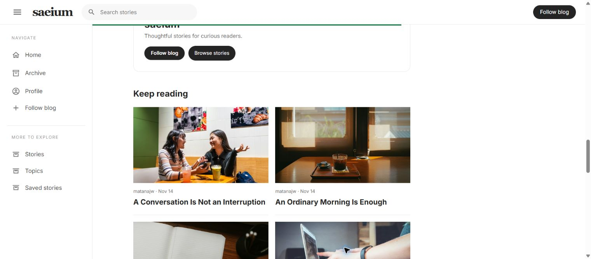

# Saeium Blogger Theme

Saeium is an original, reading-focused Blogger theme inspired by the editorial layout of [Medium](https://medium.com/). Version 1.6.2 adds a minor Free update path that preserves Blogger Layout settings from a backup. Version 1.6.1 improves article metadata and document language. Version 1.6.0 added real related-story photos, a reading progress bar, and native Blogger customization gadgets. Saeium retains Blogger's official Follow blog action, Inter interface type, Source Serif Pro article text, native threaded replies, and the mobile menu. It is an independent project and is not affiliated with Medium. See the [live Blogger demo](https://saeium.temablogger.com/).

## Features

- Responsive home, label, search, article, static page, and 404 layouts
- Persistent desktop left navigation; 235px mobile drawer with Pictogrammers icons, a Profile link, an X close state, and keyboard dismissal
- Mobile For you and Featured tabs; Featured displays the first three actual Blogger posts
- Full mobile search screen with browser-local recent searches
- Right rail with editable About, Topics, and Follow this blog gadgets, recent stories, and a browser-local reading list
- Related stories with actual post images, shared-topic ranking, configurable count, and lazy loading
- Optional article reading progress bar
- Theme settings for colors, reading width, fonts, article size, related stories, and common section labels
- Official Blogger Follow blog links in the header, navigation, sidebar, article, and footer; new posts appear in the follower's Blogger Reading List
- Inter headlines and interface text, Source Serif Pro article text, and a Georgia wordmark; fallback fonts are provided
- Feed-filled story excerpts, larger home headlines, article recommendations, author context, and working save/share controls
- Medium-inspired article structure with a publication row, topic chips, subtitle, read time, cover image, writer card, publication card, and response area
- Native Blogger threaded replies and per-comment Like controls stored in the current browser (not a shared public count)
- Comment icon and actual Blogger response count on home cards and article actions
- Editable blog title or uploaded logo through Blogger's **Header** gadget
- Editable primary navigation, explore links, footer navigation, and footer shortcuts through native **Link List** gadgets
- Editable home introduction, sidebar text, follow copy, and footer description through **HTML/JavaScript** gadgets
- Topic navigation generated from Blogger labels
- Native Blogger search, post-list pagination, and an embedded, typeable comment form
- Built-in archive at `/search?view=index` with date and topic filters
- Keyboard-accessible search and mobile menu
- No default ad placements or third-party JavaScript libraries
- Article-first page titles, article metadata, image alt text, and Blogger's canonical URLs; see the [SEO guide](docs/SEO.md)

## Support the developer

If Saeium helps your blog, please give [this repository](https://github.com/tema-blogger/Saeium-Blogger-Theme) a ⭐ Star and share its link with other Blogger users. Your support helps us maintain free themes. Thank you for valuing the developer's work.

## Free update and theme identity

Saeium runs without a purchase or activation key. TemaBlogger is identified in the theme's Layout information panel. To keep existing Blogger gadget settings, first download a Theme backup, then run `python UPDATE-FREE.py installed-backup.xml Saeium-v1.6.2.xml Saeium-updated.xml`. Upload the merged file to Blogger. Browse [Blogger templates](https://www.temablogger.com/p/template.html) on TemaBlogger.

## Install

1. Download [Saeium-v1.6.2.xml](Saeium-v1.6.2.xml).
2. In Blogger, open **Theme → More → Backup** and save your current theme.
3. Choose **Restore → Upload** and select the Saeium XML file.
4. Open **Layout** to configure the logo, navigation, introduction, topics, sidebar, and footer.
5. Add posts and labels, then check the public home, article, label, search, and archive pages.

See [Installation](docs/INSTALLATION.md) for details.

## Support via PayPal

Use GitHub's **Sponsor** button or read the [PayPal support instructions](docs/DONATE.md). The recipient is `prasojodwip@gmail.com`. The Sponsor button opens these instructions because the email-only PayPal Donate URL is unavailable for this account's country. A direct checkout link can be added when the project owner provides a verified PayPal.Me or hosted payment URL for Saeium.

## Customize

The theme uses your Blogger blog title when no logo is uploaded. In **Layout**, edit:

| Area | Gadget | What to change |
| --- | --- | --- |
| 00 Pengaturan Saeium | HTML/JavaScript | Theme appearance, labels, reading and related-story options |
| 01 Header & Logo | Header | Blog title and logo |
| 02 Menu Utama | Link List | Left rail's primary menu names, URLs, order |
| 03 Tautan Jelajah | Link List | Extra left rail links |
| 04 Pembuka Beranda | HTML/JavaScript | Heading, description, button |
| 05 Navigasi Topik | Labels | Labels shown near the top |
| 06 Postingan Blog | Blog Posts | Post count and Blogger post options |
| 07 Sidebar & Ikuti Blog | HTML/JavaScript, Labels | Introduction, topics, follow heading and copy |
| 08 Deskripsi Footer | HTML/JavaScript | Footer tagline |
| 09 Tautan Footer | Link List | Footer navigation |
| 10 Tautan Footer Tambahan | Link List | Footer shortcuts |
| 11 Kredit Footer | HTML/JavaScript | Copyright line |

Read [Customization](docs/CUSTOMIZATION.md) for examples and archive settings.

## Preview

These previews show the latest live v1.6.0 theme. The blog has six original English posts with photos. Your own blog title, posts, labels, and images will appear after installation.

| View | Preview |
| --- | --- |
| Related stories with real images, live | [Open](preview-related-v1.6.0.png) |
| Layout panel with version label and Theme settings, live | [Open](preview-layout-v1.6.0.png) |

The [mobile article and footer audit](docs/MEDIUM-ARTICLE-AUDIT.md) records the reference structure and Saeium adaptation. [Version 1.6.0 verification](docs/RELEASE-1.6.0-VERIFICATION.md) records the image, customization, responsive, and speed checks. The [SEO guide](docs/SEO.md) explains article search descriptions and indexing. Earlier verification reports record typography, following, replies, and footer checks.

## Compatibility and verification

Saeium v1.6.2 passed XML structure checks against the live v1.6.0 baseline. The [live demo](https://saeium.temablogger.com/) currently runs v1.6.0 and has six original English posts. The Layout panel displays twelve sections and fourteen native gadgets. Related covers, the settings gadget, both new Link List forms, the reading progress bar, and a 390px layout without horizontal overflow were checked live in v1.6.0. Browser timing and image-request evidence are recorded in the earlier verification report. Comment Likes and saved stories stay in the current browser and do not sync across visitors or devices; Blogger does not provide a signed-in Medium-style library through a theme.

## Credits and licensing

The layout takes inspiration from Medium's public pages but contains no Medium logo, article content, code, or imagery. The archive and mobile controls include Pictogrammers Material Design Icons under Apache 2.0; see [license](LICENSE-APACHE-2.0.txt) and [notice](PICTOGRAMMERS-NOTICE.txt). A separate license for the Saeium theme has not been selected.

## Changelog

See [CHANGELOG.md](CHANGELOG.md).
