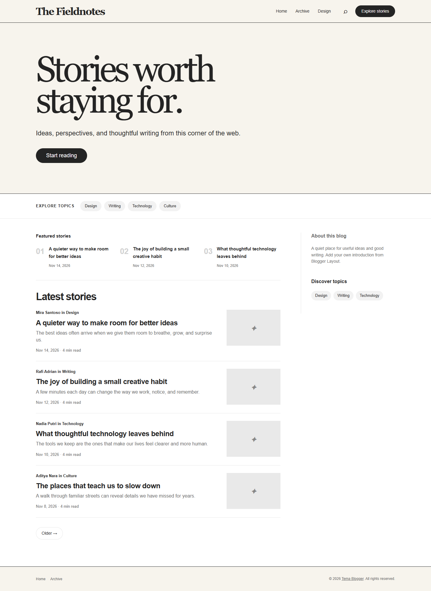

# Saeium Blogger Theme

Saeium is an original, reading-focused Blogger theme inspired by the editorial layout of [Medium](https://medium.com/). It uses a large serif introduction, clean story lists, topic links, and a narrow article column. Saeium is an independent project and is not affiliated with Medium. See the [live Blogger demo](https://saeium.blogspot.com/).

## Features

- Responsive home, label, search, article, static page, and 404 layouts
- Editable blog title or uploaded logo through Blogger's **Header** gadget
- Editable navigation and footer links through native **Link List** gadgets
- Editable home introduction and sidebar text through **HTML/JavaScript** gadgets
- Topic navigation generated from Blogger labels
- Native Blogger search, post-list pagination, and comments link
- Built-in archive at `/search?view=index` with date and topic filters
- Keyboard-accessible search and mobile menu
- No default ad placements or third-party JavaScript libraries

## Install

1. Download [Saeium-v1.0.0.xml](Saeium-v1.0.0.xml).
2. In Blogger, open **Theme → More → Backup** and save your current theme.
3. Choose **Restore → Upload** and select the Saeium XML file.
4. Open **Layout** to configure the logo, navigation, introduction, topics, sidebar, and footer.
5. Add posts and labels, then check the public home, article, label, search, and archive pages.

See [Installation](docs/INSTALLATION.md) for details.

## Customize

The theme uses your Blogger blog title when no logo is uploaded. In **Layout**, edit:

| Area | Gadget | What to change |
| --- | --- | --- |
| Header & Logo | Header | Blog title and logo |
| Main Navigation | Link List | Menu names, URLs, order |
| Home Introduction | HTML/JavaScript | Heading, description, button |
| Topic Navigation | Labels | Labels shown near the top |
| Main Content | Blog Posts | Post count and Blogger post options |
| Sidebar | HTML/JavaScript, Labels | Introduction and topics |
| Footer Links | Link List | Footer links |
| Footer Credit | HTML/JavaScript | Copyright line |

Read [Customization](docs/CUSTOMIZATION.md) for examples and archive settings.

## Preview

The screenshots use fictional sample posts and the example blog title **The Fieldnotes**. Your own blog title, posts, labels, and images will appear after installation.

| View | Preview |
| --- | --- |
| Desktop home | [Open](preview-home-1440.png) |
| Mobile home | [Open](preview-home-390.png) |
| Desktop article | [Open](preview-post-1440.png) |
| Mobile article | [Open](preview-post-390.png) |

## Compatibility and verification

Saeium v1.0.0 has passed XML structure checks, JavaScript syntax checks, and local browser previews at 1440px and 390px. It is installed on the [live demo](https://saeium.blogspot.com/), where the homepage, empty search results, archive, and header search panel were checked. The demo currently has no published posts, so article and label layouts were checked in local previews only. Your blog's native gadgets can be edited in Blogger Layout.

## Credits and licensing

The layout takes inspiration from Medium's public pages but contains no Medium logo, article content, code, or imagery. The archive module includes Pictogrammers Material Design Icons under Apache 2.0; see [license](LICENSE-APACHE-2.0.txt) and [notice](PICTOGRAMMERS-NOTICE.txt). A separate license for the Saeium theme has not been selected.

## Changelog

See [CHANGELOG.md](CHANGELOG.md).
